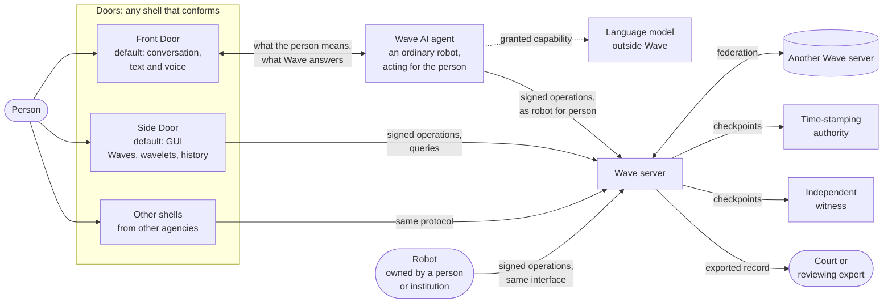
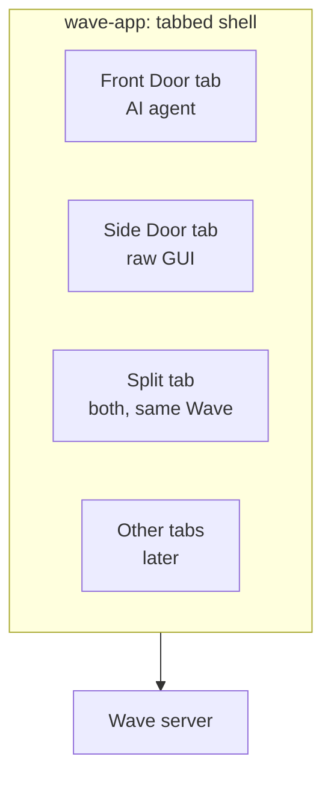
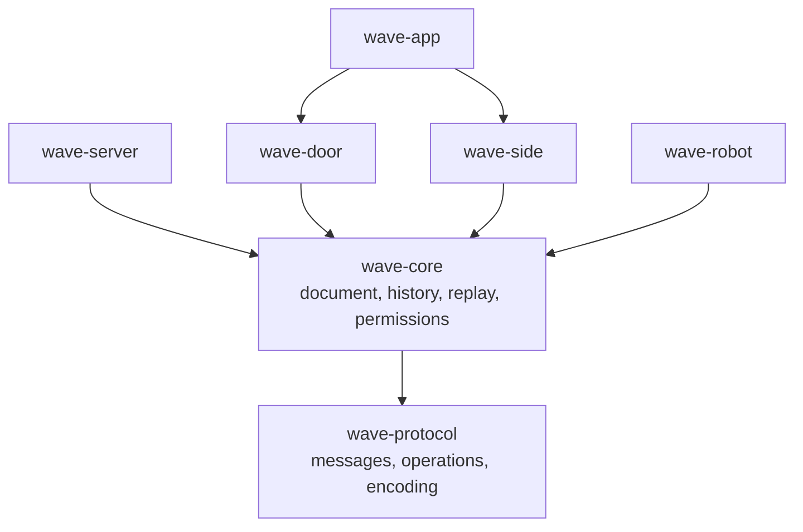
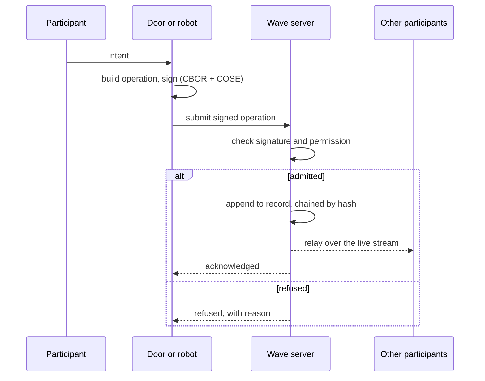

 # Wave architecture

This document describes Wave as it stands. It is edited freely. The reasons
behind it are in the [decision records](decisions/README.md), which are not.

Decisions marked **Proposed** are open for debate. Nothing here is final until
the repository is finalized.

## 1. Purpose and quality goals

Wave is a walking skeleton for Canada Wave: public collaboration
infrastructure in which people, institutions and accountable software agents
work on the same evolving object. One record, complete history, transparent
rules.

The skeleton must show two things, one on top of the other: **the shared
object**, edited by several participants at once, with every change
attributed, kept and replayable; and **the AI layer**, robots that take part as
named participants and a browser application that lets a person work with the
record by conversation or by looking at its structure.

The agent never hides the record it is working on.

Google Wave's model was sound, but its interface showed people the machinery
and too many could not fathom it. The Front Door hides that complexity for
simple tasks and for anyone who does not want to see it, at least not all the
time; the Side Door keeps it one tab away. The complexity is hidden for
convenience, never for secrecy. In 2009 nothing could translate between a
person and the structure. An AI agent now can.

Above the quality goals stands one principle: ***those among us who are the
most vulnerable require the most consideration and protection.*** A woman
fleeing abuse, looking for housing and caring for children, at a library
computer with no phone, is the person the design must not fail.

***When Wave fails, people can die*** ([0055](decisions/0055-mission-critical.md)).
Wave is mission-critical: confidentiality fails closed, the record fails
preserved, availability degrades gracefully, and Wave is never an emergency
service.

The quality goals, in order of dependence:

1. **Quality.** The code that keeps the record is correct, and can be shown to
   be correct. Tests come before features; the core library is tested with
   randomised concurrent edits that must always converge.
2. **Trustworthiness.** Every operation is signed by the participant who made
   it. Nothing reaches `main` without the checks passing. What runs on a
   server corresponds to a specific commit.
3. **Evidentiary strength.** The record can withstand scrutiny by a court of
   law, and in some cases a stronger standard: a hostile expert, given an
   exported record and the open-source verifier, can confirm or refute its
   integrity without trusting the operator.
   ([0022](decisions/0022-evidentiary-record.md))

### Horizon

A long-term goal of Wave is to replace the contemporary courtroom with a
Wave. The skeleton does not build a court, but nothing in the design may
preclude one: authority granted by law, human rulings, sealed compartments,
the open-court principle, procedure as rules, independence of the court as
admission authority, and records that outlive their cryptography.
([0031](decisions/0031-courtroom-horizon.md))

### Lineage

Wave borrows concepts from proven designs and leaves their machinery behind.

- **Apache Wave** (Google Wave, 2009–2018): the shared object, operations as
  the only way to change it, attributed and replayable history, robots as
  participants, federation. Not its RPC, its JSON mapping or its use of XMPP.
  ([0013](decisions/0013-apache-wave-lineage.md); the full comparison is in
  [Google Wave and Canada Wave](google-wave-and-canada-wave.md))
- **X.500** (ITU-T X.500 series, with LDAP as its lightweight successor): the
  administrative model of X.501, which declared visible, precisely scoped
  regions of a tree with their own rules, became Wave's bounds; operational
  bindings between directory servers inform federation and agreement. X.500
  was too heavy to adopt whole; Wave takes its ideas, not its weight.
  ([0036](decisions/0036-bounds.md))

## 2. Constraints

- **If you don't have WebAssembly, you don't have Wave.** Every part that runs,
  runs as WebAssembly. ([0002](decisions/0002-webassembly-everywhere.md))
- **Rust throughout**, with `unsafe` forbidden.
  ([0003](decisions/0003-rust-throughout.md))
- **Invent only the model; standardize everything else.**
  ([0014](decisions/0014-invent-only-the-model.md))
- **No passwords, ever.** ([0020](decisions/0020-no-passwords.md))
- **No back door.** Robots and people enter by the same interface.
  ([0010](decisions/0010-robots-same-interface.md))
- **No single provider.** A container, a network and storage are all Wave asks
  for. ([0030](decisions/0030-one-image-through-stages.md))
- **Apache Wave is lineage, not runtime.**
  ([0013](decisions/0013-apache-wave-lineage.md))

## 3. Context

People reach Wave through a door. The default Front Door is a conversation
with the Wave-supplied AI agent, which is an ordinary robot acting for the
person, with access to a language model outside Wave as a granted capability
([0035](decisions/0035-front-door-agent-is-a-robot.md)). The default Side Door
is a GUI over the raw record. Either may be
replaced by a shell from another agency that conforms to the protocol and the
design principles. Robots join through the same interface as people. Servers
federate with one another. Time and witnessing come from outside the
operator, so that an exported record can be checked by anyone.
([0033](decisions/0033-default-doors-and-tabbed-app.md))

### The default app

## 4. Building blocks

A Cargo workspace, built from source in one build. Names are provisional.
Only `wave-protocol` exists so far. What ships are WebAssembly modules: one
for the server, one for the browser, and one for each robot.

| Crate | Role |
| --- | --- |
| `wave-protocol` | The messages and operations that servers, doors and robots exchange, and the rules for encoding them. Nothing else. No dependencies. ([0017](decisions/0017-protocol-definition.md)) |
| `wave-core` | The shared object: document, operations, history, replay, permissions. No input or output. Source compiled into every component, so the server and the browser run the same code. |
| `wave-server` | Admits, stores and relays operations. Keeps the append-only record. The authority on admission, not on order. ([0005](decisions/0005-authority-on-admission.md), [0006](decisions/0006-server-as-webassembly-in-container.md)) |
| `wave-door` | The default Front Door, the Wave-supplied AI agent, and the interface every door must meet, independent of screen or voice. ([0007](decisions/0007-front-door.md), [0009](decisions/0009-door-interface-modality-independent.md)) |
| `wave-side` | The default Side Door, a GUI: at first a read-only view of structure, permissions, participants and history. ([0008](decisions/0008-side-door-early.md)) |
| `wave-robot` | The participant interface for robots, and the sandbox that hosts them. ([0010](decisions/0010-robots-same-interface.md), [0011](decisions/0011-robot-sandbox.md)) |
| `wave-app` | The browser application: a tabbed shell hosting the Front Door, the Side Door, a split view and other tabs. Holds no door logic. ([0033](decisions/0033-default-doors-and-tabbed-app.md)) |

## 5. Runtime

### Changing a Wave

Anything that changes a Wave is a signed operation. The server admits or
refuses it; it never reorders it. ([0004](decisions/0004-crdt-convergence.md),
[0005](decisions/0005-authority-on-admission.md))

### Asking about a Wave

A request that only reads uses `GET`, or `QUERY` when it needs a structured
body. It can never alter the record.
([0018](decisions/0018-asking-and-changing.md))

## 6. Interfaces

### Proposed participation profiles

[Normal and Swarm](participation-profiles.md) are proposed configurations
of one protocol: small-group collaboration and large-scale participation,
respectively. Identity, visibility, subscription and action permissions
remain independent policies. Both retain the same trust and security
requirements. The profiles, thresholds and transition rules remain open
for review; they are not implemented capabilities.

### Protocol and host interfaces

- **HTTP API with CBOR bodies**, media type `application/wave+cbor`, with a
  JSON view by content negotiation. Drafts only, for debate.
  ([0016](decisions/0016-media-type.md), [0023](decisions/0023-http-api-cbor.md))
- **HTTP/3 and IPv6 are the ground floors.** The host handles the HTTP and IP
  versions; Wave's code never sees them. HTTP/2 and IPv4 are basements, built
  before any public user. *Proposed.*
  ([0041](decisions/0041-http3-ground-floor.md),
  [0042](decisions/0042-ipv6-first.md))
- **Live stream** over WebTransport on HTTP/3, and WebSocket in the basement.
  *Proposed.* ([0041](decisions/0041-http3-ground-floor.md))
- **Robots and doors** as WebAssembly components, their boundary described in
  WIT. *Proposed.* ([0019](decisions/0019-component-interface.md))
- **Federation** between servers. Not yet designed; see the open questions in
  [0005](decisions/0005-authority-on-admission.md).

## 7. Cross-cutting concerns
### Attack resistance

Denial-of-service resistance and security apply to every Wave, not just
large public deployments. Bound ingress, expensive processing, storage,
queues and fan-out; preserve authorization and truthful acknowledgements
under overload. Authenticated participants, robots and federation peers
are not exempt. Network saturation also requires host/provider mitigation;
application rate limits alone are insufficient.
([0050](decisions/0050-attack-resistance.md))

The requirement is accepted; concrete controls and capacity guarantees
remain to be designed and tested.

### Encoding and signing

Deterministic CBOR, signed with COSE, described in CDDL, inspected in
diagnostic notation. The signed form is always CBOR; JSON is only ever a view.
Compression happens in transport or storage, never to what is signed.
*Proposed.* ([0015](decisions/0015-cbor-and-cose.md))

### The record as evidence

Every operation signed and chained by hash; nothing altered, only corrected
or redacted with a marker; time-stamps from independent authorities;
checkpoints witnessed by independent parties; a self-proving export;
reproducible builds, with the admitting server's version recorded.
([0022](decisions/0022-evidentiary-record.md))

### Views

Compartments are wavelets. Within a wavelet, each credential sees a
projection of the record; what it may not see is replaced by a salted
commitment, so every view still verifies. The open court is the view granted
to an anonymous credential. *Proposed.*
([0032](decisions/0032-verifiable-views.md))

### Bounds and without prejudice

A bound is a visible demarcation around wavelets or history, with declared
rules, after X.500's administrative areas. Without prejudice is one kind:
everyone inside sees everything, nothing flows out, and robots agree for their
principals. Capabilities are recorded as decisions; features built from them
are in [features](features.md). *Proposed.*
([0036](decisions/0036-bounds.md), [0037](decisions/0037-without-prejudice.md),
[0038](decisions/0038-agreement.md))

### Disputes

Wave is prepared for fraud and confusion. A dispute is a recorded claim with
evidence and a status, resolved by a person with authority and due process;
nothing disputed is overwritten. *Proposed.*
([0054](decisions/0054-disputes.md))

### AI interfaces

The record stays model-neutral; tokenized substitutes are not authoritative.
AI uses versioned, source-anchored derived views with authorization-scoped
retrieval and caches. MCP/A2A host adapters preserve actual signing and
delegation; substantive inter-party content is recorded, not hidden in
metadata. The derived Wave DOM provides shared semantic structure for
accessible interfaces and agents, without replacing accessibility testing.
Bounded agent metadata distinguishes observations, claims and missing
information, and is inspectable only through its authorized views.
*Proposed.* ([0056](decisions/0056-ai-ready-derived-views.md),
[0057](decisions/0057-mcp-and-a2a.md), [0058](decisions/0058-wave-dom.md))

### Safety and the flight recorder

Wave responds to what people say, never to a profile. A statement of danger
gets 9-8-8 or 911 at once, and a serious threat goes to a person with lawful
authority. Interventions are graduated, disclosed, overridable and recorded;
no single signal triggers strong action. *Proposed.*
([0061](decisions/0061-safety-response-and-graduated-intervention.md))

Every check answers within a stated time and says whether it is complete;
partial is never presented as clean. *Proposed.*
([0060](decisions/0060-bounded-labelled-checks.md))

Every server keeps a flight recorder: a tamper-evident record of the
system's own behaviour, without secrets or protected content, for learning
from incidents. *Proposed.* ([0059](decisions/0059-flight-recorder.md))

### Robot governance

Robots are governed in two layers: constraints the architecture enforces, and
a published charter of conduct, whose hash travels with every operation the
robot signs. A deployment may add rules and may mandate its doors, but a
person can always see their own record. *Proposed.*
([0039](decisions/0039-robot-governance.md),
[0040](decisions/0040-deployments-may-mandate-doors.md),
[robot governance](robot-governance.md))

### Data

The log is the truth: its tail is appended in PostgreSQL and periodically
sealed into object storage, time-stamped and witnessed. Blobs live in object
storage, named by hash and individually encrypted. Everything else is derived
and rebuildable. Storage is the host's business; scaling is by federation.
*Proposed.* ([0043](decisions/0043-data-strategy.md), [data](data.md))

### Identity

No one remembers a password; passkeys for people. One person, one identity,
with aliases and pseudonyms tied back to it. Assurance on a spectrum from anonymous to
the highest a deployment needs, attached to actions rather than to people.
Recovery low-friction until security matters. Doors without a passkey gather
evidence until it meets the standard the action needs.
([0020](decisions/0020-no-passwords.md),
[0021](decisions/0021-identity-assurance-spectrum.md),
[0046](decisions/0046-passwords-scope.md),
[0047](decisions/0047-one-person-one-identity.md))

## 8. Deployment

One container image moves unchanged through alpha (Docker on a developer's
machine), beta (TrueNAS, with one server in a container and another in a
virtual machine for federation) and, later, production in a commercial cloud.
([0030](decisions/0030-one-image-through-stages.md))

The development and demonstration instance is **Ztuph Wave**, under
`ztuph.com`: hosts, DNS, certificates and firewall are in
[environments](environments.md).

Candidate platforms, none yet evaluated:

- **Canadian-owned:** ThinkOn, Micrologic, TELUS, Bell.
- **Other, outside the United States:** OVHcloud and Scaleway (France),
  Hetzner, IONOS and STACKIT (Germany), Exoscale and Infomaniak
  (Switzerland), UpCloud (Finland).
- **United States:** AWS, Azure, Google Cloud, Oracle.

Where a provider is owned decides whose law can reach the data. That is a
policy question for whoever deploys Wave.

## 9. Risks and open questions

In the order they block work:

1. **Can the server run as WebAssembly with the networking it needs?**
   ([0026](decisions/0026-server-webassembly-runtime.md))
2. **Identifiers.** ([0028](decisions/0028-identifiers.md))
3. **The signed-operation envelope**, including delegation and erasure.
   ([0029](decisions/0029-signed-operation-envelope.md))
4. **Which CRDT library.** ([0025](decisions/0025-crdt-library.md))
5. **Admission under federation.**
   ([0005](decisions/0005-authority-on-admission.md))
6. **HTTP/3 and IPv6 in practice:** browsers, networks, and the runtime.
   ([0041](decisions/0041-http3-ground-floor.md),
   [0042](decisions/0042-ipv6-first.md))

7. **Sealed manifest authority:** what proves the sealed record if PostgreSQL
   is lost. ([0045](decisions/0045-postgresql-schemas.md))
8. **Acknowledgement durability:** which of the three levels an
   acknowledgement promises. ([0043](decisions/0043-data-strategy.md))

Items 2 to 4 precede the first test vector and the endpoints; Oz's [database
review](reviews/2026-11-21-oz-database.md) lists what precedes the first
migration.

## Deferred, not forgotten

- The full Side Door: editing through it, and making it fit for the public.
- Voice, telephone and text-message doors. Accounted for in the door interface
  from the start.
