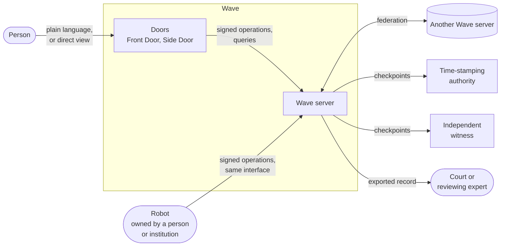
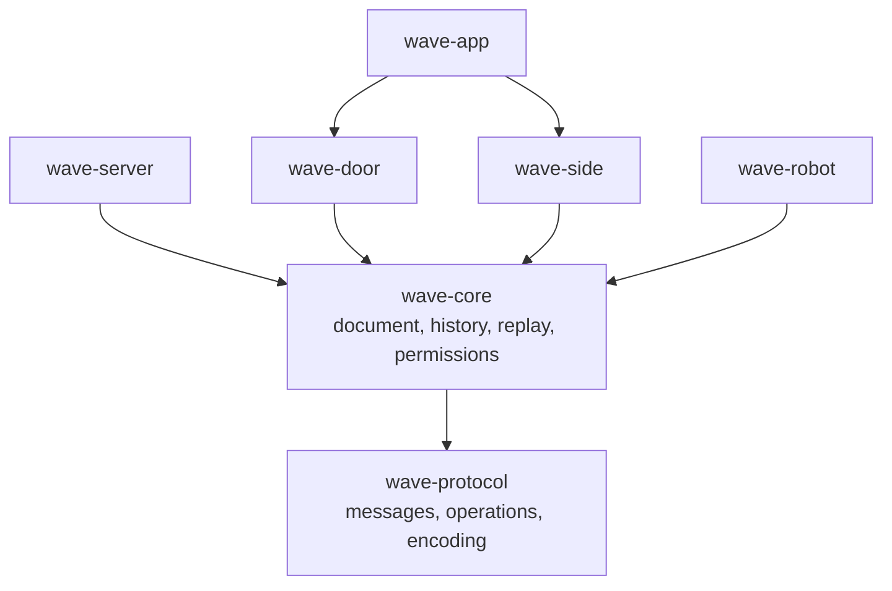
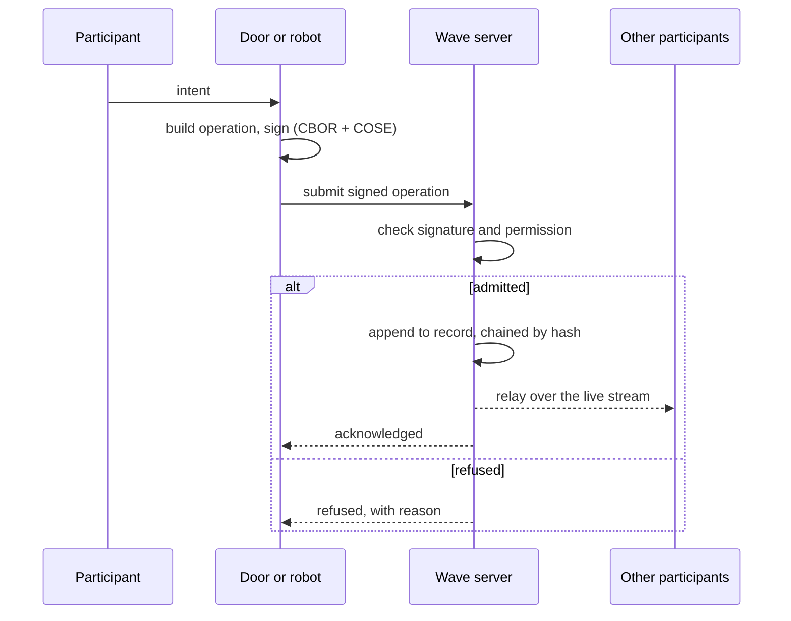

# Wave architecture

This document describes Wave as it stands. It is edited freely. The reasons
behind it are in the [decision records](decisions/README.md), which are not.

Decisions marked **Proposed** are open for debate. Nothing here is final until
the repository is finalized.

## 1. Purpose and quality goals

Wave is a walking skeleton for Canada Wave: public collaboration
infrastructure in which people, institutions and accountable software agents
work on the same evolving object. One record, complete history, transparent
rules.

The skeleton must show two things, one on top of the other: **the shared
object**, edited by several participants at once, with every change
attributed, kept and replayable; and **the AI layer**, robots that take part as
named participants and a browser application that lets a person work with the
record by conversation or by looking at its structure.

The agent never hides the record it is working on.

The quality goals, in order of dependence:

1. **Quality.** The code that keeps the record is correct, and can be shown to
   be correct. Tests come before features; the core library is tested with
   randomised concurrent edits that must always converge.
2. **Trustworthiness.** Every operation is signed by the participant who made
   it. Nothing reaches `main` without the checks passing. What runs on a
   server corresponds to a specific commit.
3. **Evidentiary strength.** The record can withstand scrutiny by a court of
   law, and in some cases a stronger standard: a hostile expert, given an
   exported record and the open-source verifier, can confirm or refute its
   integrity without trusting the operator.
   ([0022](decisions/0022-evidentiary-record.md))

### Horizon

A long-term goal of Wave is to replace the contemporary courtroom with a
Wave. The skeleton does not build a court, but nothing in the design may
preclude one: authority granted by law, human rulings, sealed compartments,
the open-court principle, procedure as rules, independence of the court as
admission authority, and records that outlive their cryptography.
([0031](decisions/0031-courtroom-horizon.md))

## 2. Constraints

- **If you don't have WebAssembly, you don't have Wave.** Every part that runs,
  runs as WebAssembly. ([0002](decisions/0002-webassembly-everywhere.md))
- **Rust throughout**, with `unsafe` forbidden.
  ([0003](decisions/0003-rust-throughout.md))
- **Invent only the model; standardize everything else.**
  ([0014](decisions/0014-invent-only-the-model.md))
- **No passwords, ever.** ([0020](decisions/0020-no-passwords.md))
- **No back door.** Robots and people enter by the same interface.
  ([0010](decisions/0010-robots-same-interface.md))
- **No single provider.** A container, a network and storage are all Wave asks
  for. ([0030](decisions/0030-one-image-through-stages.md))
- **Apache Wave is lineage, not runtime.**
  ([0013](decisions/0013-apache-wave-lineage.md))

## 3. Context

People reach Wave through a door. Robots join through the same interface as
people. Servers federate with one another. Time and witnessing come from
outside the operator, so that an exported record can be checked by anyone.

## 4. Building blocks

A Cargo workspace, built from source in one build. Names are provisional.
Only `wave-protocol` exists so far. What ships are WebAssembly modules: one
for the server, one for the browser, and one for each robot.

| Crate | Role |
| --- | --- |
| `wave-protocol` | The messages and operations that servers, doors and robots exchange, and the rules for encoding them. Nothing else. No dependencies. ([0017](decisions/0017-protocol-definition.md)) |
| `wave-core` | The shared object: document, operations, history, replay, permissions. No input or output. Source compiled into every component, so the server and the browser run the same code. |
| `wave-server` | Admits, stores and relays operations. Keeps the append-only record. The authority on admission, not on order. ([0005](decisions/0005-authority-on-admission.md), [0006](decisions/0006-server-as-webassembly-in-container.md)) |
| `wave-door` | The Front Door, and the interface every door must meet, independent of screen or voice. ([0007](decisions/0007-front-door.md), [0009](decisions/0009-door-interface-modality-independent.md)) |
| `wave-side` | The minimal Side Door: a read-only view of structure, permissions, participants and history. ([0008](decisions/0008-side-door-early.md)) |
| `wave-robot` | The participant interface for robots, and the sandbox that hosts them. ([0010](decisions/0010-robots-same-interface.md), [0011](decisions/0011-robot-sandbox.md)) |
| `wave-app` | The browser application. Hosts the doors, with door mode, raw mode and a split screen. ([0012](decisions/0012-browser-application.md)) |

## 5. Runtime

### Changing a Wave

Anything that changes a Wave is a signed operation. The server admits or
refuses it; it never reorders it. ([0004](decisions/0004-crdt-convergence.md),
[0005](decisions/0005-authority-on-admission.md))

### Asking about a Wave

A request that only reads uses `GET`, or `QUERY` when it needs a structured
body. It can never alter the record.
([0018](decisions/0018-asking-and-changing.md))

## 6. Interfaces

- **HTTP API with CBOR bodies**, media type `application/wave+cbor`, with a
  JSON view by content negotiation. Drafts only, for debate.
  ([0016](decisions/0016-media-type.md), [0023](decisions/0023-http-api-cbor.md))
- **Live stream** over WebSocket, with WebTransport to be tested. *Proposed.*
  ([0024](decisions/0024-live-stream-transport.md))
- **Robots and doors** as WebAssembly components, their boundary described in
  WIT. *Proposed.* ([0019](decisions/0019-component-interface.md))
- **Federation** between servers. Not yet designed; see the open questions in
  [0005](decisions/0005-authority-on-admission.md).

## 7. Cross-cutting concerns

### Encoding and signing

Deterministic CBOR, signed with COSE, described in CDDL, inspected in
diagnostic notation. The signed form is always CBOR; JSON is only ever a view.
Compression happens in transport or storage, never to what is signed.
*Proposed.* ([0015](decisions/0015-cbor-and-cose.md))

### The record as evidence

Every operation signed and chained by hash; nothing altered, only corrected
or redacted with a marker; time-stamps from independent authorities;
checkpoints witnessed by independent parties; a self-proving export;
reproducible builds, with the admitting server's version recorded.
([0022](decisions/0022-evidentiary-record.md))

### Views

Compartments are wavelets. Within a wavelet, each credential sees a
projection of the record; what it may not see is replaced by a salted
commitment, so every view still verifies. The open court is the view granted
to an anonymous credential. *Proposed.*
([0032](decisions/0032-verifiable-views.md))

### Identity

No passwords. Passkeys for people. Assurance on a spectrum from anonymous to
the highest a deployment needs, attached to actions rather than to people.
Recovery low-friction until security matters. Doors without a passkey gather
evidence until it meets the standard the action needs.
([0020](decisions/0020-no-passwords.md),
[0021](decisions/0021-identity-assurance-spectrum.md))

## 8. Deployment

One container image moves unchanged through alpha (Docker on a developer's
machine), beta (TrueNAS, with one server in a container and another in a
virtual machine for federation) and, later, production in a commercial cloud.
([0030](decisions/0030-one-image-through-stages.md))

Candidate platforms, none yet evaluated:

- **Canadian-owned:** ThinkOn, Micrologic, TELUS, Bell.
- **Other, outside the United States:** OVHcloud and Scaleway (France),
  Hetzner, IONOS and STACKIT (Germany), Exoscale and Infomaniak
  (Switzerland), UpCloud (Finland).
- **United States:** AWS, Azure, Google Cloud, Oracle.

Where a provider is owned decides whose law can reach the data. That is a
policy question for whoever deploys Wave.

## 9. Risks and open questions

In the order they block work:

1. **Can the server run as WebAssembly with the networking it needs?**
   ([0026](decisions/0026-server-webassembly-runtime.md))
2. **Identifiers.** ([0028](decisions/0028-identifiers.md))
3. **The signed-operation envelope**, including delegation and erasure.
   ([0029](decisions/0029-signed-operation-envelope.md))
4. **Which CRDT library.** ([0025](decisions/0025-crdt-library.md))
5. **Admission under federation.**
   ([0005](decisions/0005-authority-on-admission.md))
6. **The live-stream transport.**
   ([0024](decisions/0024-live-stream-transport.md))

Items 2 to 4 precede the first test vector and the endpoints.

## Deferred, not forgotten

- The full Side Door: editing through it, and making it fit for the public.
- Voice, telephone and text-message doors. Accounted for in the door interface
  from the start.
