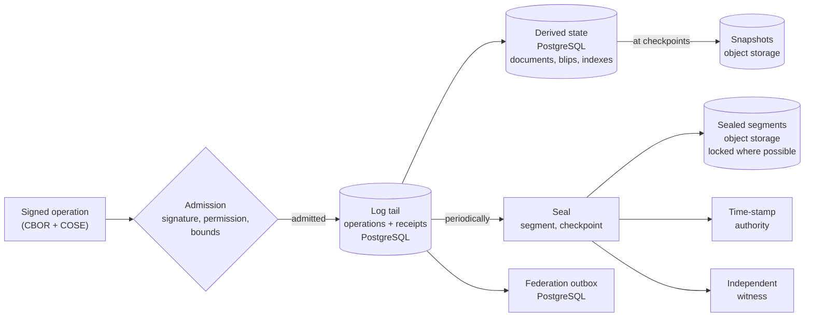

# Data

How Wave keeps its data. The decision is
[0043](decisions/0043-data-strategy.md); identifiers are in
[0028](decisions/0028-identifiers.md). Everything here is a draft for debate.

> ***The log is the truth. Blobs are referenced by hash. Everything else is
> derived and rebuildable.***

## The journey of an operation

1. A participant signs an operation.
2. The server admits it, or refuses it.
3. Admitted, it is appended to the log's tail in PostgreSQL, in one
   transaction with its admission receipt: the server's own record of
   admitting it, with a position in that server's admission sequence. The
   position is a replay cursor, not the CRDT's order.
4. Derived state is updated, and the operation is queued for any federated
   servers.
5. Periodically the tail is sealed into a segment in object storage,
   time-stamped by an independent authority and witnessed by an independent
   party. From then on PostgreSQL's copy of it is derived.

## Three kinds of data

**The log** is the record, in two parts kept apart. **Operations** are exactly
what participants signed, linked by their causal dependencies; the server
never adds to them. **Admission receipts** are the server's own record of
admitting each one: position, observed time, rules and build, chained by hash
to the previous receipt. The tail of both is primary data until sealed; sealed
segments are the long-term record.

**Derived state** is what the doors read: current documents, blips, views,
indexes. It is materialized in PostgreSQL for speed and can always be rebuilt
by replaying the log. Snapshots sealed at checkpoints make replay quick, and
each can be verified by hash against the log.

**Artifacts** are blobs: attachments, audio, video, exports, evidence
packages. They live in object storage, named by the hash of their content and
referenced from operations by that hash. Each is encrypted with its own key.
Destroying the key makes the stored blob unreadable while the record still
proves something was there. It does not recall copies already disclosed, nor
plaintext that reached snapshots, backups, indexes or embeddings. The exact
guarantee is to be settled in [0029](decisions/0029-signed-operation-envelope.md)
and [0032](decisions/0032-verifiable-views.md).

## What PostgreSQL is for

- The unsealed tail of the log: operations and admission receipts, appended
  in one transaction, with each wavelet's stream head as the only mutable
  row in the record schema.
- Current state: documents, blips and views, for the doors.
- Indexes: participants, permissions, bound membership, history ranges for
  QUERY, full-text search, and semantic search for agents (pgvector).
- The federation outbox, so operations owed to other servers are delivered
  reliably.
- The identity directory's public data, such as passkey public keys.

## What PostgreSQL is not for

- The long-term record: that is sealed segments.
- Blobs: those are in object storage.
- Private keys: those belong in a key-management service or hardware security
  module, never in a database.

## Durability

Three levels, never confused: committed on one server; acknowledged by a
synchronous replica; sealed, time-stamped and witnessed. An acknowledgement
says which level it reached. A single development instance reaches only the
first.

## Identifiers

- **Immutable things are named by hash**: operations, blobs, segments,
  snapshots.
- **Evolving things are named by UUIDv7**: Waves, wavelets, participants,
  robots, bounds.
- **No auto-increment keys.**
- **The database never generates identifiers.** They are chosen by the signer
  of the operation that creates the thing they name.

## Storage is the host's business

The Wave component never knows which cloud it runs on. It uses a small storage
interface of its own, defined in WIT, which the host implements:

- append operations to a wavelet's log;
- read a range of a wavelet's log;
- put and get a blob by hash.

The skeleton can implement it with plain files, then S3 and PostgreSQL, with
no change to the component. WASI's own storage proposals (wasi-keyvalue,
wasi-blobstore) are to be adopted as they mature; wasi-sql has been dropped
from the wasi-cloud-core proposal.

## Scaling

No national database. A nationwide deployment is many Wave servers, each the
home of its own Waves, each with its own PostgreSQL and a streaming replica
for failover, joined by federation. Object storage scales almost without
limit. Federation is the scaling strategy, as it is for email.

## Export

A Wave exports as its sealed segments, snapshots and blobs: CBOR or raw
bytes, every piece named by hash or UUID, verifiable offline
([0022](decisions/0022-evidentiary-record.md)).
